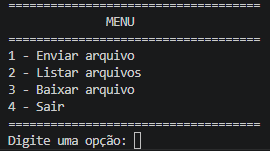
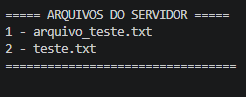
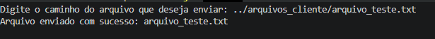
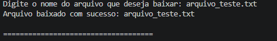

# SICA — Sistema de Compartilhamento de Arquivos

Aplicação desenvolvida em **Java** para compartilhamento de arquivos entre um cliente e um servidor por meio de uma conexão de rede utilizando o protocolo **TCP (Transmission Control Protocol)**.

O sistema permite que o cliente envie arquivos para o servidor, consulte os arquivos disponíveis e faça o download de arquivos armazenados no servidor.

---

## 📌 Sobre o projeto

O **SICA (Sistema de Compartilhamento de Arquivos)** foi desenvolvido como projeto acadêmico para aplicação prática dos conceitos de **Aplicações Cliente/Servidor** e **comunicação por sockets TCP**.

A aplicação utiliza uma arquitetura simples de comunicação:

```text
┌─────────────────────┐
│       CLIENTE       │
│                     │
│  • Enviar arquivo   │
│  • Listar arquivos  │
│  • Baixar arquivo   │
│  • Encerrar conexão │
└──────────┬──────────┘
           │
           │ TCP
           │
           ▼
┌─────────────────────┐
│      SERVIDOR       │
│                     │
│  • Receber arquivos │
│  • Listar arquivos  │
│  • Enviar arquivos  │
│  • Gerenciar acesso │
└─────────────────────┘
```

---

## 🎯 Objetivo

Desenvolver uma aplicação capaz de realizar a transferência de arquivos entre computadores por meio de uma comunicação cliente/servidor utilizando **sockets TCP**, permitindo:

- Enviar arquivos do cliente para o servidor;
- Listar os arquivos armazenados no servidor;
- Baixar arquivos do servidor para o cliente;
- Estabelecer uma comunicação confiável entre as aplicações;
- Trabalhar com arquivos de diferentes tamanhos;
- Aplicar conceitos de programação de redes em Java.

---

## 🛠️ Tecnologias utilizadas

- **Java 21**
- **TCP/IP**
- **Java Sockets**
- `ServerSocket`
- `Socket`
- `DataInputStream`
- `DataOutputStream`
- `FileInputStream`
- `FileOutputStream`
- Visual Studio Code
- Git e GitHub

---

## 🏗️ Arquitetura

O sistema utiliza o modelo **Cliente/Servidor**.

### Cliente

O cliente é responsável pela interação com o usuário e pelo envio das solicitações ao servidor.

Suas principais funções são:

1. Enviar arquivos;
2. Listar arquivos disponíveis no servidor;
3. Solicitar o download de arquivos;
4. Encerrar a conexão.

### Servidor

O servidor permanece executando e aguardando conexões na porta **5000**.

Após receber uma conexão, ele processa os comandos enviados pelo cliente.

Suas principais funções são:

1. Receber arquivos;
2. Listar arquivos armazenados;
3. Enviar arquivos ao cliente;
4. Encerrar a conexão solicitada pelo cliente;
5. Permanecer disponível para novas conexões.

---

## 🔌 Comunicação TCP

A comunicação entre o cliente e o servidor é realizada utilizando o protocolo **TCP**.

O servidor é iniciado na porta:

```text
5000
```

O cliente estabelece a conexão utilizando:

```text
localhost:5000
```

Durante o desenvolvimento e os testes, cliente e servidor foram executados no mesmo computador. Entretanto, a estrutura do sistema permite que o cliente se conecte a um servidor localizado em outro computador da mesma rede, desde que o endereço IP e a porta estejam configurados corretamente.

---

## 📡 Protocolo de comunicação

O sistema utiliza comandos simples para determinar qual operação deverá ser realizada.

| Comando | Função |
|---|---|
| `ENVIAR` | Envia um arquivo para o servidor |
| `LISTAR` | Solicita a lista de arquivos do servidor |
| `BAIXAR` | Solicita o download de um arquivo |
| `SAIR` | Encerra a conexão com o servidor |

### Fluxo básico

```text
Cliente                         Servidor
   │                               │
   │──── conexão TCP ─────────────>│
   │                               │
   │──── comando ─────────────────>│
   │                               │
   │<──── resposta ────────────────│
   │                               │
   │──── dados ───────────────────>│
   │                               │
   │<──── confirmação ──────────────│
   │                               │
```

---

# 📤 Envio de arquivos

Para enviar um arquivo, o cliente seleciona a opção:

```text
1 - Enviar arquivo
```

O usuário informa o caminho do arquivo que deseja enviar.

O cliente então envia ao servidor:

1. Comando `ENVIAR`;
2. Nome do arquivo;
3. Tamanho do arquivo;
4. Conteúdo do arquivo.

Os dados são enviados em blocos de **4096 bytes**, evitando a necessidade de carregar o arquivo inteiro na memória.

Após receber o arquivo, o servidor armazena o conteúdo na pasta:

```text
arquivos_servidor
```

Ao finalizar, o servidor envia uma confirmação ao cliente.

Exemplo:

```text
Arquivo enviado com sucesso: arquivo_teste.txt
```

---

# 📋 Listagem de arquivos

Para visualizar os arquivos disponíveis no servidor, o cliente utiliza:

```text
2 - Listar arquivos
```

O cliente envia o comando:

```text
LISTAR
```

O servidor verifica os arquivos existentes na pasta `arquivos_servidor` e retorna a quantidade e o nome de cada arquivo.

Exemplo:

```text
===== ARQUIVOS DO SERVIDOR =====
1 - teste.txt
2 - arquivo_teste.txt
=================================
```

---

# 📥 Download de arquivos

Para baixar um arquivo armazenado no servidor, o cliente utiliza:

```text
3 - Baixar arquivo
```

O usuário informa o nome do arquivo desejado.

O servidor verifica se o arquivo existe.

Caso exista, envia:

1. Confirmação de existência;
2. Tamanho do arquivo;
3. Conteúdo do arquivo.

O cliente recebe os dados e salva o arquivo na pasta:

```text
arquivos_cliente
```

Exemplo:

```text
Digite o nome do arquivo que deseja baixar: arquivo_teste.txt

Arquivo baixado com sucesso: arquivo_teste.txt
```

---

# 📁 Estrutura do projeto

```text
SICA/
│
├── src/
│   ├── Cliente.java
│   └── Servidor.java
│
├── arquivos_cliente/
│   └── arquivo_teste.txt
│
├── arquivos_servidor/
│   └── teste.txt
│
└── README.md
```

### `src/`

Contém os códigos-fonte da aplicação:

- `Cliente.java` — implementação do cliente;
- `Servidor.java` — implementação do servidor.

### `arquivos_cliente/`

Diretório utilizado pelo cliente para armazenar os arquivos recebidos por meio de download.

### `arquivos_servidor/`

Diretório utilizado pelo servidor para armazenar os arquivos enviados pelos clientes.

### `README.md`

Documento que apresenta a descrição, funcionamento, estrutura e instruções do projeto.

---

# ▶️ Como executar

## 1. Pré-requisitos

É necessário possuir o **Java Development Kit (JDK)** instalado.

Versão utilizada no desenvolvimento:

```text
Java 21
```

Para verificar a versão instalada:

```bash
java -version
```

E:

```bash
javac -version
```

---

## 2. Acessar a pasta do projeto

No terminal:

```bash
cd C:\Users\Wicole\Desktop\SICA\src
```

---

## 3. Compilar o servidor

Execute:

```bash
javac Servidor.java
```

---

## 4. Iniciar o servidor

Execute:

```bash
java Servidor
```

O servidor deverá apresentar:

```text
====================================
           SERVIDOR SICA
====================================
Servidor iniciado na porta 5000

Aguardando conexão...
```

---

## 5. Abrir outro terminal

Mantenha o servidor em execução.

Abra outro terminal e acesse novamente a pasta `src`:

```bash
cd C:\Users\Wicole\Desktop\SICA\src
```

---

## 6. Compilar o cliente

Execute:

```bash
javac Cliente.java
```

---

## 7. Iniciar o cliente

Execute:

```bash
java Cliente
```

O sistema apresentará o menu:

```text
====================================
              MENU
====================================
1 - Enviar arquivo
2 - Listar arquivos
3 - Baixar arquivo
4 - Sair
====================================
Digite uma opção:
```

---

# 🧪 Testes realizados

Durante o desenvolvimento, foram realizados testes das principais funcionalidades do sistema.

### Teste de conexão

Foi verificada a comunicação entre o cliente e o servidor por meio de uma conexão TCP na porta `5000`.

**Resultado:** ✅ Funcionando.

### Teste de envio

Foi utilizado um arquivo de teste localizado na pasta:

```text
arquivos_cliente/arquivo_teste.txt
```

O arquivo foi enviado ao servidor e armazenado em:

```text
arquivos_servidor/
```

**Resultado:** ✅ Funcionando.

### Teste de listagem

Após o envio, o cliente solicitou a listagem dos arquivos armazenados no servidor.

**Resultado:** ✅ Funcionando.

### Teste de download

O cliente solicitou o download de um arquivo armazenado no servidor.

O arquivo foi recebido e salvo na pasta:

```text
arquivos_cliente/
```

**Resultado:** ✅ Funcionando.

### Teste de encerramento

O cliente utilizou a opção:

```text
4 - Sair
```

Após o encerramento, o servidor permaneceu ativo e voltou ao estado:

```text
Aguardando conexão...
```

Isso permite que novas conexões sejam estabelecidas.

**Resultado:** ✅ Funcionando.

---

# 📸 Demonstração




### Listagem de arquivos



### Envio de arquivo



### Download de arquivo



---

# 🔐 Considerações sobre segurança

O sistema implementa algumas medidas básicas para evitar problemas no armazenamento dos arquivos.

Ao receber o nome de um arquivo, o sistema utiliza somente o nome do arquivo, desconsiderando caminhos de diretórios externos.

Exemplo:

```java
new File(nomeArquivo).getName();
```

Isso evita que um caminho informado pelo cliente seja utilizado diretamente como local de armazenamento.

Além disso, os arquivos são transferidos em blocos de 4096 bytes, permitindo trabalhar com arquivos maiores sem precisar carregá-los integralmente na memória.

> **Observação:** este projeto possui finalidade acadêmica e não implementa autenticação, criptografia ou controle de permissões de usuários. Para utilização em um ambiente real, seriam necessárias medidas adicionais de segurança.

---

# 📚 Conceitos aplicados

O desenvolvimento do SICA permitiu aplicar conceitos relacionados a:

- Programação orientada a objetos;
- Aplicações Cliente/Servidor;
- Comunicação em redes;
- Protocolo TCP;
- Sockets;
- Fluxos de entrada e saída;
- Manipulação de arquivos;
- Transferência de dados em blocos;
- Tratamento de exceções;
- Estruturação e organização de projetos Java.

---

# 🎓 Contexto acadêmico

Projeto desenvolvido como atividade prática relacionada aos conteúdos de:

**Especificação de requisitos** e **Aplicações Cliente/Servidor**.

O sistema foi desenvolvido com o objetivo de demonstrar, de forma prática, a comunicação entre aplicações por meio de sockets TCP e a transferência de arquivos através de uma arquitetura cliente/servidor.

---

# 👨‍💻 Autor

**Wicole Lopes**

Projeto acadêmico desenvolvido em Java.

---

# 📄 Licença

Este projeto foi desenvolvido para fins acadêmicos e de aprendizado.

Sinta-se livre para consultar o código e utilizar o projeto como referência para estudos.